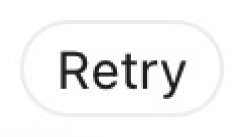

# Codex Retry 自动点击器

自动在屏幕上找到 Codex 的 **Retry** 按钮，按钮一出现就点击；点完后继续监控，下次再失败时还会继续点。



- 基于屏幕模板匹配，不依赖 Codex 的内部接口、DOM 或辅助功能树。
- 支持 Retina（@2x）与多显示器，自动换算像素/坐标。
- 多尺度搜索：窗口缩放、页面缩放、不同 DPI 都能适配。
- 深色模式降级模板 + 边缘模式（可选）。
- 窗口过滤：默认不会点截图查看器里显示的按钮图片，避免“点自己的模板”。
- 防狂点：同一次显示最多点 2 次，点击冷却、每分钟限速、持续卡住告警。
- 安全开关：`--dry-run`、`--scan`、`--max-clicks`、`--once`、左上角紧急停止。

---

## 环境要求

- macOS 12+（Intel / Apple Silicon 均可）
- Python 3.9+
- 第一次运行需要授予 **屏幕录制** 和 **辅助功能** 权限

项目自带的 `.venv` 已经装好依赖；如果需要重装：

```bash
python3 -m venv .venv
.venv/bin/pip install -r requirements.txt
```

依赖：`numpy`、`opencv-python`、`Pillow`、`pyobjc-framework-Quartz`。

---

## 权限（第一次必看）

macOS 的权限是授予**运行程序的终端 App**，不是授予 Python：

1. **屏幕录制**：系统设置 → 隐私与安全性 → 屏幕录制
2. **辅助功能**：系统设置 → 隐私与安全性 → 辅助功能

勾选 Terminal / iTerm / Warp / VS Code（取决于你在哪里运行），然后**完全退出并重新打开该终端**。

辅助功能只用于“模拟鼠标点击”；如果只做检测（`--scan` / `--dry-run`），只缺辅助功能也能运行。

```bash
./run.sh --check-permissions   # 检查两项权限
./run.sh --open-permissions    # 直接打开设置面板
```

输出示例：

```
权限检查：
  辅助功能: ✅ 已授权，可以模拟点击
  屏幕录制: ✅ 正常（2880x1800 像素）
```

---

## 快速开始

```bash
# 1) 安全验证：扫描一次，看看当前屏幕能不能识别出 Retry
./run.sh --scan --debug

# 2) 模拟运行：正常循环检测，但不点击
./run.sh --dry-run

# 3) 正式运行：找到就点击
./run.sh
```

启动时会倒计时 3 秒，方便你切到 Codex 窗口。

停止方式：

- 在终端按 `Ctrl+C`
- 把鼠标移到屏幕**左上角**（默认开启的紧急停止）
- 用 `--stop-file .stop` 启动时，执行 `touch .stop` 即可停止（文件会自动删除）

后台运行：

```bash
nohup ./run.sh --stop-file .stop >/tmp/codex-retry.log 2>&1 &
# 停止：
touch .stop
```

日志同时写入 `logs/retry_clicker.log`（自动轮转）。

---

## 常用参数

| 参数 | 默认值 | 说明 |
| --- | --- | --- |
| `--scan` | - | 只扫描一次并输出结果，不点击 |
| `--dry-run` | - | 循环检测但不点击 |
| `--once` | - | 成功点击一次后退出 |
| `--max-clicks N` | `0` | 点击 N 次后退出，0 为不限制 |
| `--duration N` | `0` | 运行 N 秒后退出 |
| `--poll-interval N` | `0.6` | 扫描间隔（秒） |
| `--threshold F` | `0.88` | 最终验证阈值，越高越严格 |
| `--modes LIST` | `color,dark` | 匹配模式；深色界面可加 `edge` |
| `--template-dpi N` | `2.0` | 模板截图的像素密度（@2x 为 2） |
| `--scale-tolerance F` | `0.12` | 缩放搜索范围 ±12% |
| `--deep-interval N` | `4.0` | 每隔 N 秒做一次宽范围深度扫描 |
| `--include-owner REGEX` | 空 | 只点击匹配的窗口（匹配“应用名 — 标题”） |
| `--exclude-owner REGEX` | 内置 | 永不点击的窗口；默认排除 Preview/DSH 等截图查看器 |
| `--no-window-filter` | - | 关闭窗口过滤，搜索整个屏幕（更容易误点） |
| `--debug [DIR]` | `debug` | 保存带标注的命中截图 |
| `--stop-file PATH` | 空 | 该文件出现时停止 |
| `--no-failsafe` | - | 关闭左上角紧急停止 |
| `--no-cursor-restore` | - | 点击后不恢复鼠标位置 |
| `-v` / `-q` | - | 调试日志 / 只输出警告 |

完整参数：`./run.sh --help`。

### 示例

```bash
# 只点击一次，并保存调试截图
./run.sh --once --debug

# 深色模式：多试一种边缘匹配，阈值稍微放宽
./run.sh --modes color,dark,edge --threshold 0.84

# 只允许标题中含 Codex 的窗口（浏览器标签页标题也算）
./run.sh --include-owner "Codex"

# 低配/省电：只跑浅色模式，2 秒扫一次
./run.sh --modes color --poll-interval 2

# 最多点 5 次，最多跑 30 分钟
./run.sh --max-clicks 5 --duration 1800
```

---

## 工作原理

1. **截图**：通过 Quartz 逐屏截取物理像素（Retina 为 2x）。
2. **粗匹配**：把截图缩到长边 1024px，在多个缩放比例下用
   `cv2.matchTemplate`（归一化相关系数）搜索模板。
   - 预期缩放 = 屏幕像素密度 / 模板像素密度。
   - 例如 2x 屏幕 + @2x 模板 → 1.0；1x 屏幕 → 0.5。
3. **精验证**：把候选位置映射回原始分辨率，重新匹配并微调缩放，
   低于 `--threshold` 的结果直接丢弃。这一步能过滤掉 0.7~0.8 分的
   “Retried model request” 之类的文字误报。粗匹配分数 ≥0.96 时直接
   进入精验证并返回，不用把所有缩放比例跑完。
4. **窗口过滤**：取命中点最上层的窗口（`CGWindowListCopyWindowInfo`
   的顺序就是前后顺序），默认排除 Preview、Photos、DSH Desktop 等
   可能显示模板图片的 App。
5. **点击**：用 `CGEventCreateMouseEvent` 发送移动到 / 按下 / 抬起事件，
   点击后默认把鼠标移回原位，避免按钮一直处于 hover 状态。
6. **防抖状态机**：
   - 同一次“按钮出现”只点一次；
   - 4 秒后按钮仍然可见才允许第二次尝试（`--max-attempts 2`）；
   - 连续两次扫描都看不到按钮才认为“消失”，避免动画闪一下导致重复点击；
   - 按钮消失后重新进入等待，下次失败时再次点击；
   - 全程受每分钟点击上限保护。

---

## 模板

默认模板来自你提供的截图：

- 原图：`assets/reference/retry_button_original@2x.jpg`
- 按钮区域（像素）：`x=39, y=50, w=101, h=48`
- 带 10px 上下文裁出的模板：`assets/templates/retry_button.png`（121x68）
- 预览：`assets/retry_button_preview.png`

### 重新制作模板

按钮改版、主题变化、或者你换了一张截图时：

```bash
# 从当前屏幕交互框选（会弹出一个可缩放的窗口）
.venv/bin/python tools/make_template.py

# 或从已有截图按像素坐标裁剪
.venv/bin/python tools/make_template.py screenshot.png \
    --box 39,50,101,48 --margin 10 \
    --out assets/templates/retry_button.png
```

建议：

- 框住整个胶囊按钮，四周留 8~12px 背景；
- 不要框入太多其他文字或图标；
- 浅色和深色主题可各放一份模板到 `assets/templates/`，程序会全部尝试；
- 裁剪后执行 `./run.sh --scan --debug` 验证。

### 用图片离线验证模板

```bash
.venv/bin/python tools/scan_image.py screenshot.png --image-dpi 2 --debug /tmp/hit.png
```

会用同一套匹配器输出命中位置和分数，不会操作鼠标。

---

## 调试与排障

### `--scan` 说“未找到”

1. 确认按钮真的显示在屏幕上，没有被其他窗口挡住。
2. 用 `--scan --debug` 看标注图，确认模板和实际按钮是否一致。
3. 主题不同：加 `--modes color,dark,edge`，或换一张对应当前主题的模板。
4. 尺寸差异大：调整 `--scale-tolerance 0.3`、`--template-dpi 1`。
5. 截图全黑：检查屏幕录制权限。
6. 阈值过高：试 `--threshold 0.82`。

### 找到了但显示“已过滤”

`--scan` 会显示命中的窗口名，例如：

```
2. ⛔ 已过滤 | 分数 0.998 ... | 窗口: 已排除窗口: DSH Desktop
```

说明匹配到的是聊天里显示的模板预览，这是有意的保护。请把 Codex 窗口切到前面，
或临时用 `--no-window-filter`（不推荐）。

### 点击没反应

- 辅助功能权限没给：`./run.sh --check-permissions`；
- 授权后没有重启终端；
- Retry 按钮本身是禁用状态（比如请求还在进行中）；
- 点击坐标被其他窗口遮挡：窗口过滤默认只按“命中点上最上层的窗口”判断，
  遮挡时通常不会被匹配到。

### 误点其他地方

- 保持窗口过滤开启；把会显示按钮图片的 App 加入 `--exclude-owner`；
- 提高 `--threshold 0.92`；
- 用 `--include-owner "Codex"` 限定目标窗口；
- 不要一边运行一边在 Preview/聊天里查看 `retry_button.png`。

### 性能

一次扫描约 0.2 秒（按钮出现时通常更短，会命中快速路径并提前返回），
默认 0.6 秒轮询，所以从按钮出现到点击通常在 1 秒内。程序每 4 秒做一次
更宽范围的“深度扫描”，兼顾非常规缩放比例。想更省 CPU：

```bash
./run.sh --modes color --poll-interval 1.5
```

如果觉得还不够快，可以 `--poll-interval 0.3`（扫描本身约 0.1~0.2 秒，
再快就会持续占满一个 CPU 核）。

---

## 退出码

| 退出码 | 含义 |
| --- | --- |
| `0` | 正常运行结束 / 扫描到可点击按钮 |
| `1` | `--scan` 没有找到按钮 |
| `2` | 参数或模板错误 |
| `3` | 权限或屏幕访问失败 |

---

## 开发与测试

```bash
PYTHONDONTWRITEBYTECODE=1 .venv/bin/python -m unittest discover -s tests -t . -v
```

测试覆盖：

- 多尺度 / 多 DPI / Retina 坐标换算；
- 深色降级与误报（空白屏幕、普通文字）；
- 窗口前后顺序与 include/exclude 策略；
- 点击状态机：只点一次、消失后重置、速率限制、点击失败重试；
- 模板加载、调试截图输出和 CLI 参数。

### 目录结构

```
├── main.py                     # 入口
├── run.sh                      # 启动脚本（优先使用 .venv）
├── retry_clicker/
│   ├── cli.py                  # 参数、启动、scan/dry-run
│   ├── config.py               # MatcherConfig / WatcherConfig
│   ├── screen.py               # Quartz 截图与坐标换算
│   ├── windows.py              # 窗口列表与过滤策略
│   ├── templates.py            # 模板加载
│   ├── matcher.py              # 多尺度匹配 + 原生分辨率验证
│   ├── scanner.py              # 多屏扫描 + 窗口过滤 + 调试标注
│   ├── clicker.py              # CGEvent 鼠标点击
│   ├── watcher.py              # 防抖 / 限速状态机
│   ├── permissions.py          # 权限检查与设置面板
│   └── logging_setup.py        # 控制台 + 文件日志
├── assets/
│   ├── templates/retry_button.png
│   ├── retry_button_preview.png
│   └── reference/retry_button_original@2x.jpg
├── tools/
│   ├── make_template.py        # 交互/坐标裁模板
│   └── scan_image.py           # 对图片离线跑匹配
└── tests/
```

---

## 说明与限制

- 这是**屏幕模板匹配**，不是 OCR，也不是 Codex 插件：按钮样式大改时需要换模板。
- 只支持 macOS（依赖 Quartz）。
- 屏幕锁定/休眠时无法点击；程序会持续扫描，解锁后恢复。
- 强行关闭 Auxiliary / 使用 `--no-window-filter` 时，理论上可能点中同款按钮，
  请结合 `--dry-run` 和 `--include-owner` 使用。
- 程序不会修改 Codex、不会注入进程，也不会读取你的聊天内容；它只截屏并匹配按钮图像。
